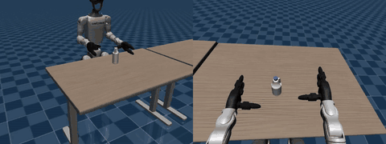
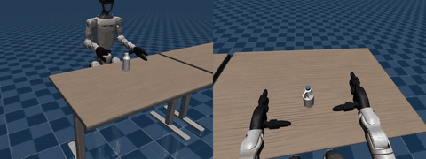
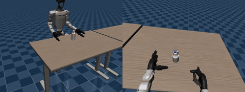
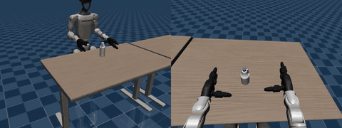
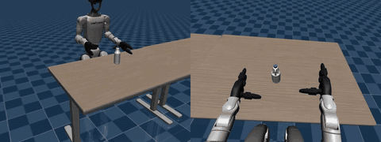
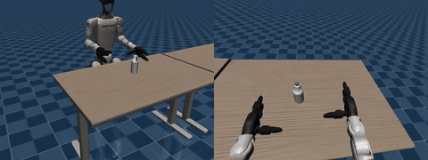
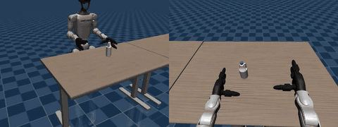
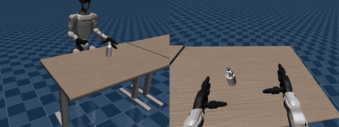

# vla-humanoid

Fine-tuning NVIDIA's GR00T N1.7 to control a Unitree G1 humanoid on a single 16 GB GPU.

The task: "Pick up the bottle and place it on the other table". The robot walks up to a table, grabs the bottle with its right hand, side-steps about 1 m to a second table and puts the bottle down upright. Everything runs in MuJoCo on one RTX 5080. No VR headset and no real robot.

## Demonstration



## Approach

The legs are handled by NVIDIA's [whole-body controller](https://github.com/NVlabs/GR00T-WholeBodyControl), an RL policy that takes a walk command and a base height. GR00T sits on top of it. It sees the head camera, the joint state and the instruction, and outputs arm, hand and waist targets plus the walk and height commands.

### Demos without a teleoperator

NVIDIA's data pipeline expects someone in VR. Instead, we drive the same teleop interface from code (`expert/harness.py`), and a scripted expert (`expert/pnp_bottle.py`) does the task using the true object poses from the simulator. It succeeds on 49 of 50 seeds. Episodes are saved with NVIDIA's exporter, so GR00T's fine-tuning reads them as is.

### DART

A policy trained only on clean demos never sees a mistake, so small errors snowball at test time. Following [DART](https://arxiv.org/abs/1703.09327), the expert executes noisy actions but the dataset stores its clean command. We add noise to the wrist, and also to the walk command, where the expert sometimes overshoots the stop point on purpose and walks back. The walk noise is what fixed the "walks past the end of the table" failures.

### Fitting in a 16 GB GPU

The default fine-tune trains the whole action head and doesn't fit. Therefore, we (`scripts/finetune_g1.py`) wrap GR00T's launcher and add LoRA (rank 32) on the DiT and the VL self-attention, train only the G1 slot of the embodiment projector, and keep frozen weights in bf16. That gives about 50M trainable parameters and a 12.4 GB peak at batch 32. 30k steps take about 3.5 hours. LoRA is merged back when saving, so checkpoints work with GR00T's stock server.

## Results

Success rate on held-out seeds. An episode counts when the bottle stays upright on the target table for at least 1 s.

| Policy                     | Training data                    | Success     |
| -------------------------- | -------------------------------- | ----------- |
| GR00T N1.7, no fine-tuning | none                             | 0/20        |
| Fine-tuned v1              | 300 clean + 250 wrist-DART demos | 43/50 (86%) |
| Fine-tuned v2              | v1 data + 300 walk-DART demos    | 44/50 (88%) |
| Scripted expert            | (uses true object poses)         | 49/50 (98%) |

The base model has never seen this robot setup. Its first action chunk jumps the waist and arms far from the rest pose and trips the simulator's safety stop (within 0.1 s). With the safety stop off, it waves the right hand over its head and never goes near the bottle.

Failures by type (number of episodes out of 50):

| Failure                              | v1    | v2    |
| ------------------------------------ | ----- | ----- |
| Bottle tips over when it is set down | 3     | 6     |
| Robot side-steps past the table      | 2     | 0     |
| Robot stalls before the grasp        | 2     | 0     |
| **Total**                            | **7** | **6** |

The walk-DART data in v2 removed the overshoots and stalls. All of v2's remaining failures are tip-overs on release (the rise from 3 to 6 is within run-to-run variation at 50 seeds), *so a gentler release is the next thing to work on*.

## Videos

Left: third-person view. Right: the head camera, which is the only image the policy gets. 3x speed.

| Scripted expert                                   | Base model, no fine-tuning (safety stop off)        |
| ------------------------------------------------- | --------------------------------------------------- |
|                   |                |
| **Fine-tuned v1**                                 | **Fine-tuned v2**                                   |
|                   |                     |
| **v1: walks past the table**                      | **v1: stalls before the grasp**                     |
|       |                 |
| **v2: bottle tips over on release**               | **v2: knocks the bottle over while grasping**       |
|  |  |

Actions are sampled, so the same seed doesn't always give the same result. For example, the last clip is a failure that didn't show up in the 50-seed eval but appeared while recording videos.

## Setup

We tested on Ubuntu 24.04 with an RTX 5080, using `uv`, `git-lfs` and `ffmpeg`, which `torchcodec` needs. Note that NVIDIA's repos are pulled in as unmodified submodules under `third_party/`.

```bash
git clone --recurse-submodules https://github.com/ravijo/vla-humanoid.git && cd vla-humanoid
cd third_party/Isaac-GR00T && uv sync --python 3.12 && cd ../..   # GR00T env
scripts/install_wbc_sim.sh                                        # Simulator env (Python 3.10)
```

GR00T and the simulator need different Python versions, so they run as two processes talking over ZMQ. The base model uses the gated `nvidia/Cosmos-Reason2-2B` backbone, so don't forget to log in to Hugging Face and accept its license first.

## Usage

The easiest way is `scripts/pipeline.sh`, which collects the data, trains and evaluates. v1 takes about 5.5 hours (roughly 1.5 h collecting data, 3.5 h training, 0.5 h evaluating) whereas v2 reuses v1's data and takes about 4.5 hours.

```bash
scripts/pipeline.sh v1    # clean + wrist-DART demos
scripts/pipeline.sh v2    # adds walk-DART demos and retrains on everything
scripts/pipeline.sh base  # GR00T N1.7 without fine-tuning, for comparison
```

Or step by step. Training seeds start at 1000 whereas seeds 0-999 are for evaluation.

```bash
# Render the simulator on the GPU without a display
export MUJOCO_GL=egl

# Optional: run the scripted expert on 50 evaluation seeds and print its success rate
.venvs/wbc/bin/python scripts/expert_eval.py --n 50

# Record 50 successful expert demos
.venvs/wbc/bin/python scripts/collect.py --episodes 50 --seed0 4000 --noise 0.02 --nav-noise --out data/nav_dart_0

# Compute the normalisation statistics (GR00T needs it for a new dataset)
(cd third_party/Isaac-GR00T && .venv/bin/python gr00t/data/stats.py \
    --dataset-path ../../data/nav_dart_0 --embodiment-tag UNITREE_G1)

# Fine-tune GR00T with LoRA and use absolute paths
PYTORCH_CUDA_ALLOC_CONF=expandable_segments:True third_party/Isaac-GR00T/.venv/bin/python \
    scripts/finetune_g1.py --base-model-path nvidia/GR00T-N1.7-3B --embodiment-tag UNITREE_G1 \
    --dataset-path $PWD/data/nav_dart_0 --output-dir $PWD/outputs/my_lora \
    --global-batch-size 32 --max-steps 30000 --save-steps 2500

# Evaluation (need two terminals)
# Terminal 1: serve the fine-tuned model on port 5555
# Keep it running. Stop it by Ctrl+C once done
(cd third_party/Isaac-GR00T && .venv/bin/python gr00t/eval/run_gr00t_server.py \
    --model-path ../../outputs/my_lora/checkpoint-30000 --embodiment-tag UNITREE_G1 --port 5555)

# Terminal 2: run the robot in the simulator, controlled by the model
MUJOCO_GL=egl .venvs/wbc/bin/python scripts/closed_loop_eval.py --n 50 --video 5 --out outputs/closed_loop/my_lora
```

Data collection occasionally crashes in the video encoder. So if something goes wrong please run it again.

## Credits

- Built on NVIDIA's [Isaac-GR00T](https://github.com/NVIDIA/Isaac-GR00T) and [GR00T-WholeBodyControl](https://github.com/NVlabs/GR00T-WholeBodyControl), which in turn use robosuite and RoboCasa.
- [DART](https://arxiv.org/abs/1703.09327) is from Laskey et al., CoRL 2017.
